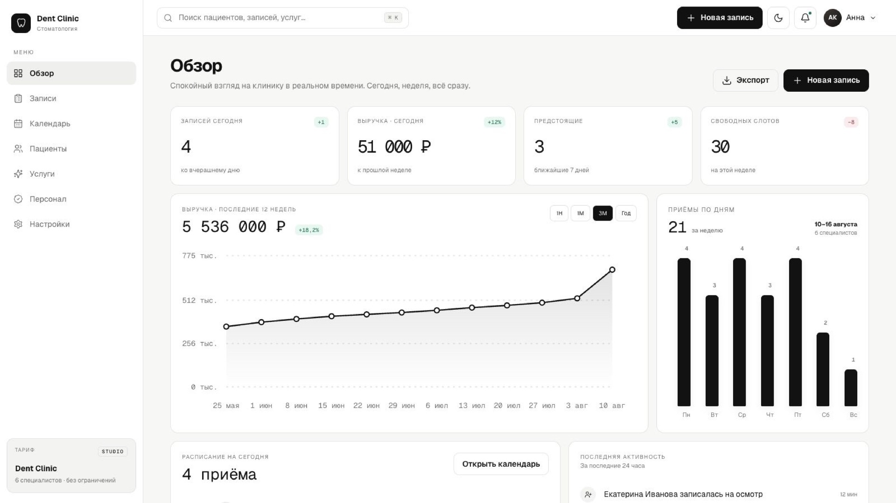

# Dent Clinic CRM

**Рабочее пространство для администратора клиники**

[Открыть демо](https://vagapov-studio.netlify.app/portfolio/salon-manager/site/)

## Задача

Объединить ежедневные задачи администратора в одном интерфейсе и сделать расписание клиники наглядным.

## Возможности

- Обзор записей и основных показателей.
- Календарь и управление визитами.
- Карточки пациентов и связанные данные.
- Разделы персонала и услуг.
- Общая навигация, таблицы и быстрые действия для повседневной работы.

## Реализация

HTML, CSS и JavaScript, интерфейс одностраничного приложения. Акцент — на структуре рабочих сценариев и удобстве работы с данными.

Проектирование сценариев, дизайн интерфейса, адаптация и разработка — Vagapov Studio.

## Статус

В портфолио представлено демонстрационное рабочее пространство. Демо предназначено для тестовых данных; медицинские сведения реальных пациентов вводить не следует.

## Связаться

[Обсудить проект в Telegram](https://t.me/vagapov_studio) · [Написать на почту](mailto:vagapov.studio.pro@gmail.com) · [Сайт студии](https://vagapov-studio.netlify.app/)

---

Публичный кейс: описание, изображения и ссылки на демонстрацию. Исходный код проекта закрыт.
